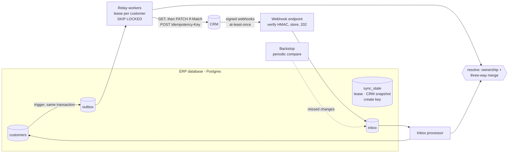

# erp-sync-starter

**Two-way sync between a Postgres ERP and a CRM that stays correct when the network, the CRM and
your own workers misbehave.**

Every "keep NetSuite / xTuple / our database in sync with Salesforce / HubSpot" project starts
as a cron job that copies rows. Then the CRM times out after saving and the retry creates a
duplicate. A webhook arrives twice, or out of order, or never. Two workers update the same
customer. A change made by the sync bounces back as a "new" change and loops. Somebody edits
the same field in both systems. This repository is a small, complete answer to each of those.

## Architecture



| Problem | How it is handled |
|---|---|
| Change saved but never published (or published but rolled back) | **Transactional outbox** written by a Postgres trigger — captures writes from legacy code that knows nothing about the sync |
| CRM commits a create, then the response is lost | One **idempotency key per customer**, reused on every retry; the replayed result is diffed against the current ERP row |
| Two workers writing one customer | **Lease per customer**, claimed with `FOR UPDATE SKIP LOCKED`; the commit re-checks the lease (fencing) |
| Someone edits the contact between our read and write | `PATCH` with **`If-Match`** version → 412 → re-read, never blind overwrite |
| Ten edits in a row | Workers send the **current state**, not each event: ten edits → one PATCH |
| Timeouts, 5xx, 429 | **Exponential backoff with full jitter**, honours `Retry-After`; keeps retrying through an outage (24 h window) |
| CRM rejects the data (4xx) | **Dead-letter queue** immediately, admin endpoint to inspect and replay; the customer stays blocked rather than silently skipped |
| Webhook delivered twice / out of order | Inbox keyed on event id; events older than the last seen CRM version are ignored |
| Webhook forged or replayed | **HMAC-SHA256** over `timestamp.body`, 5-minute tolerance, constant-time compare |
| Sync's own write comes back as a webhook | Sync writes set a transaction-local `erpsync.origin = 'sync'` the trigger respects; CRM echoes are recognised by version |
| Same field edited on both sides | **Field ownership** + **three-way merge** against the last known CRM state (below) |
| Webhooks lost entirely | **Backstop** compares the CRM with the last snapshot and feeds differences through the normal inbox path |

### Conflict resolution

```python
POLICY = {
    "name": "shared",  # three-way merge
    "email": "crm",  # sales keep contact details current
    "phone": "crm",
    "credit_limit": "erp",  # finance owns credit and status
    "status": "erp",
}
```

One function, `resolve(erp, crm, base)`, decides the target state for both directions. For a
shared field it compares each side with the **base** — the CRM record as it was when the systems
last agreed — so it knows *which side actually changed it*. Row-level "last writer wins" gets
this wrong: rename a contact in the CRM, then edit only the credit limit in the ERP, and the
ERP row looks newer, so the rename is overwritten. Only when both sides changed the same field is
it a real conflict, decided by recency.

## Proving it

The tests run against real Postgres (triggers, `SKIP LOCKED` and leases are the point).

- **Chaos convergence.** 300 random operations on both systems while the CRM returns 15 % 500s,
  5 % 429s, commits-then-504s 10 % of the time, the client loses 5 % of write responses, and
  webhooks are duplicated (20 %), reordered and dropped (5 %). Afterwards both systems must hold
  identical data, nothing may be duplicated, nothing pending, and the only dead letters must be
  the records with deliberately invalid data. 4 seeds run in CI; a sweep of 30 seeds passed
  during development. The test also asserts that retries, duplicates and drops actually
  happened — a convergence test that never exercised a failure would prove nothing.
- **Concurrency.** Four relay threads against a real HTTP CRM while 600 edits land on 150
  customers: no duplicate creates and **zero** `If-Match` conflicts, i.e. no two workers ever
  wrote the same contact concurrently.
- **Mutation checks.** Removing the idempotency key, the echo guard or the stale-version check
  each makes a test fail.
- **Live stack.** `docker compose up` with two worker containers, faults on, 100 customers and
  800 edits across both systems, workers restarted mid-traffic: converged with 564 events sent,
  0 dead, and `erpsync check` reporting 0 differences. A deliberate silent edit made it report 1.

### Bugs these tests caught while building it

Each is now a regression test.

1. **Idempotent replay returned stale data.** A create committed, the response was lost, the ERP
   was edited, and the retry's idempotency key correctly returned the *original* record — so the
   edits were marked sent but never reached the CRM. Found by the live stack, not the unit tests.
2. **Row-level last-writer-wins lost CRM renames** → replaced with the three-way merge.
3. **Snapshot advanced past a concurrent ERP edit**, turning a CRM change into an apparent ERP
   change on the next pass → the commit now aborts and re-reads if the ERP row moved.
4. **Outages dead-lettered healthy customers** when retries were capped by count → transient
   failures now retry for a time window; only rejected data is dead-lettered.
5. **Migrations on every process start deadlocked live writes** (DDL takes `ACCESS EXCLUSIVE`)
   → a one-shot `migrate` step runs before the API and workers.
6. **Contacts created in the CRM never received the ERP's defaults** for fields the ERP owns.

## Run it

```bash
docker compose up --build                     # postgres, migrate, mock CRM, API, 2 workers
uv run python scripts/traffic.py              # edits on both sides with CRM faults on
curl localhost:8000/metrics                   # outbox / inbox gauges (Prometheus format)
docker compose run --rm worker check          # exit 0 when both systems agree
docker compose run --rm worker backstop       # recover changes whose webhooks were lost
```

Dev mode (source mounted, API and workers restart on code changes, Postgres on `localhost:5436`):

```bash
docker compose -f docker-compose.yml -f docker-compose.dev.yml up --build
# API http://localhost:8020/docs · mock CRM http://localhost:8021/docs
```

The three repos use different dev ports, so they can run side by side.

Tests (needs a Postgres; CI uses a service container):

```bash
docker run -d -p 55432:5432 -e POSTGRES_PASSWORD=test -e POSTGRES_DB=erpsync_test postgres:17-alpine
uv sync && uv run pytest
```

## Endpoints

| | |
|---|---|
| `POST /webhooks/crm` | Verify signature, store in inbox, `202` |
| `GET /metrics` | `erpsync_outbox_events{status}`, `erpsync_outbox_oldest_pending_seconds`, `erpsync_inbox_pending` |
| `GET /admin/dead-letters` | Customers blocked by rejected data, with the CRM's error |
| `POST /admin/dead-letters/{id}/replay` | Re-queue after fixing the data |
| `/erp/customers` | Stand-ins for the ERP application (plain SQL writes; the trigger does the rest) |

## Adapting it

- **Your ERP table:** point the trigger at it and list the synced columns; the sync tables can
  live in their own schema next to the ERP's.
- **Your CRM:** implement `CrmClient` (create with an idempotency key or an external-id upsert,
  get, conditional update, list). Salesforce: external ID upsert + `If-Unmodified-Since`;
  HubSpot: `idProperty` upsert.
- **Your policy:** edit `POLICY`; everything else follows from it.

## Limits

- Deletes are not synced (archive/close via `status` instead).
- One entity type; more types repeat the same outbox/inbox per entity.
- The shared-field tie-break relies on reasonably synchronised clocks; prefer ownership where
  possible.

## License

MIT
